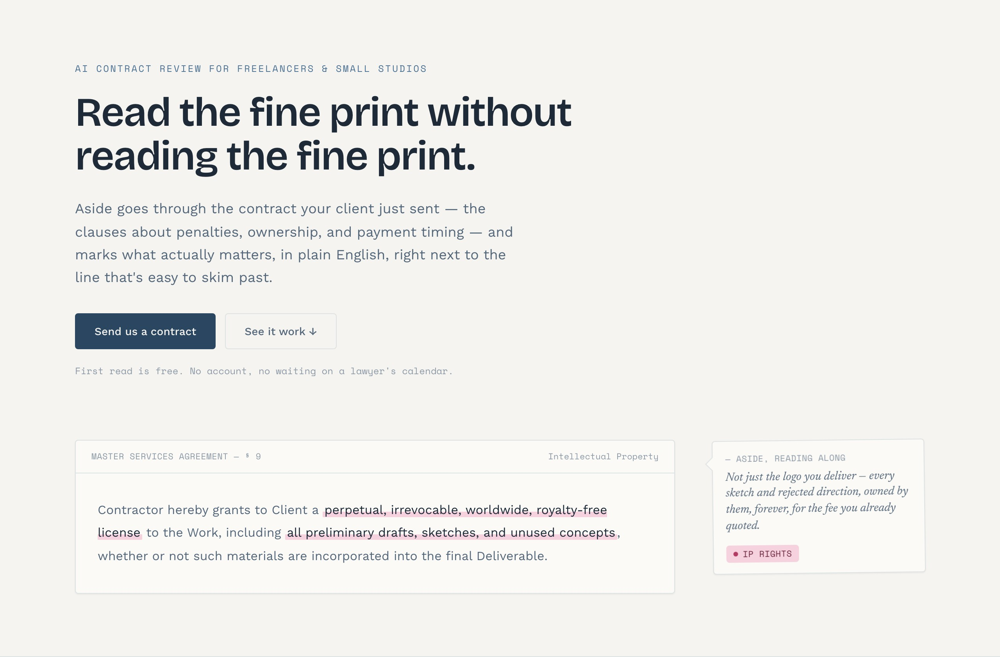
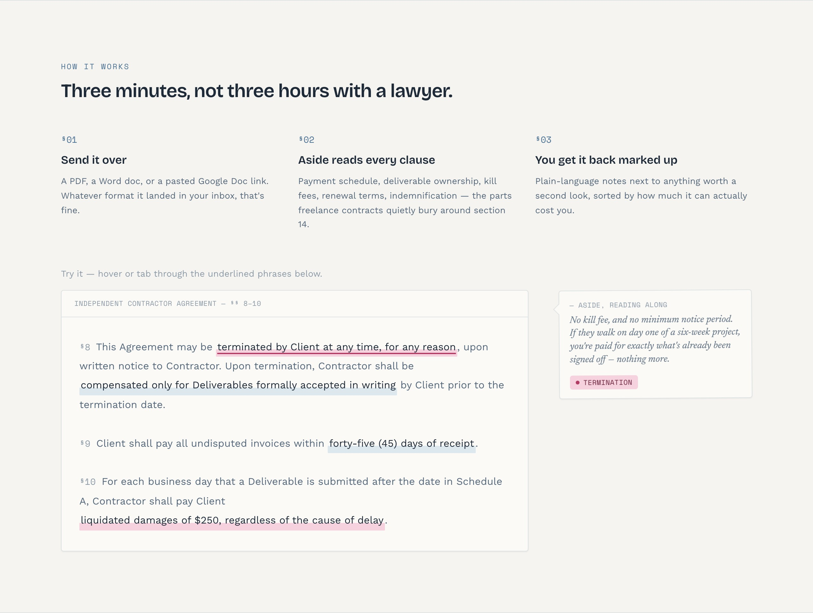

# Aside

Landing page for **Aside**, a concept AI tool that reads freelance contracts and flags the clauses that quietly cost solo freelancers money: one-sided penalties, IP grabs, slow payment terms, asymmetric termination.

**Live:** https://aside-igorworks.vercel.app

> This is a design case study, not a working product. There is no contract-analysis backend behind it; the site says so in its own footer note.



## Idea

A product about reading contracts closely shouldn't be pitched with a generic SaaS feature grid. The whole site borrows the look of an annotated document: a content column with a narrow margin of tilted notes in the AI's voice, and highlighter marks that sweep across risky phrases.

## What's on the page

- **Interactive clause demo.** Hovering or tabbing through a real contract clause swaps in the matching margin note and risk tag.
- **Four clause categories** with risk levels: penalties, IP ownership, payment timing, termination and kill fees.
- **Philosophy section** on where an AI review tool should stop and a human should take over.
- **Contact form** with required-field validation and file upload (front end only).



## Accessibility

Every interactive mark is a real focusable button with `aria-pressed` state, not a hover-only effect. Reveal animations and highlights respect `prefers-reduced-motion`, and the whole page works from the keyboard.

## Stack

React 19, Vite, Tailwind CSS 4, deployed on Vercel. Section scaffolding and first-pass copy were drafted with an AI coding agent; layout, interactions and accessibility were finished by hand.

## Run locally

```bash
npm install
npm run dev
```

Part of my portfolio: https://madebyigor.vercel.app
